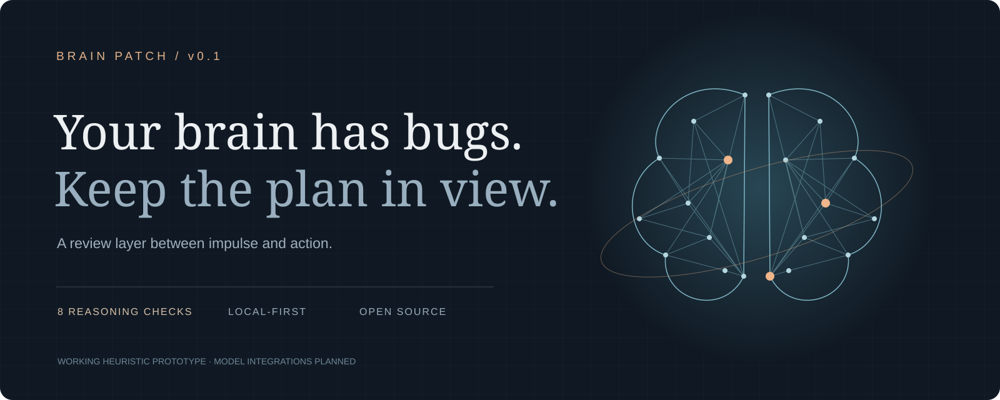

# Brain Patch

### Your brain has bugs. Keep the plan in view.

A local-first decision review prototype. Write down your reasoning before a trade, inspect possible cognitive-bias cues, and keep the original plan beside your next explanation.



**Working offline demo · 8 transparent checks · Local journal · MIT**

This is the first small implementation of the “AI patch” idea: an external review layer between an impulse and a decision. The current backend is deterministic JavaScript, **not a connected LLM or a clinical bias detector**. The animated brain is a decorative schematic.

## Run it

Requires Node.js 20+ and a modern browser. No install, account or API key needed.

```bash
git clone https://github.com/Frankweb33/brain-patch.git
cd brain-patch
npm start
```

Open **http://127.0.0.1:8096**. The server binds to loopback only. `PORT=8097 npm start` selects a different port.

```bash
npm test
npm run demo
node cli.mjs --file examples/decision.json
```

## What works today

- A decision receipt: thesis, supporting observations, reconsideration condition, time horizon and your own position-size limit.
- Eight phrase-based checks: confirmation, anchoring, survivorship, herding, authority, sunk cost, overconfidence and outcome bias.
- Exact matched wording, a review question and an explanation for every cue.
- Position-limit arithmetic and missing-information checks.
- A browser-local journal. Load an earlier receipt, edit the plan, then review to see what changed while the evidence stayed the same.
- JSON exports of an individual review or the whole journal.
- Three synthetic scenarios, an abstract animated neural schematic, responsive layouts and reduced-motion support.

The four review roles are **real local checks**, not four remote agents: Researcher checks whether evidence was supplied; Skeptic checks whether you wrote a reconsideration condition; Rule checker compares the position with your limit; Memory compares revisions. None verifies external facts.

## Try the full loop

1. Load **The old high**, then click **Review my reasoning**.
2. Inspect the anchoring and overconfidence cues and your position-limit mismatch.
3. Save the decision receipt.
4. Change the time horizon or position size without changing the evidence.
5. Review again. The original plan stays available and the change is made explicit.
6. Export the receipt if you want to inspect the JSON outside the app.

Nothing connects to a wallet, executes a trade or sends your input to a server. Browser storage is unencrypted and limited to 50 receipts. Clearing browser data removes it; exports are your backup. Do not enter secrets or private keys.

## How it fits together

```text
Decision receipt
      ↓
Phrase checks + missing information + user limits
      ↓
Previous receipt comparison
      ↓
Inspectable review → human decision → local snapshot
```

`src/engine.mjs` is a pure review engine shared by the browser and CLI. `src/app.mjs` renders results using text nodes, manages local storage and draws the illustrative point-cloud brain. `server.mjs` serves an explicit allowlist of public files; it does not expose your journal or arbitrary repository files.

See [architecture](docs/architecture.md) for the boundaries and an example of the planned model integration.

## What comes next

- [x] Runnable local workspace and CLI
- [x] Eight inspectable phrase checks
- [x] Receipt snapshots, revision comparisons and exports
- [x] Unit tests and GitHub Actions workflow
- [ ] Server-side model adapter with source citations and structured output
- [ ] Separate source-research and counterargument agents
- [ ] Read-only browser or messaging integrations
- [ ] Prospective evaluation against a simple checklist, including false alarms

## Limits worth knowing

Phrase checks can miss a bias or flag a sentence discussing one. They do not understand negation, sarcasm or context reliably. A match does not establish your mental state. No match does not mean a safe or rational trade. Supplied evidence is text, not verified research. There are no live market feeds, profit predictions, calibrated probabilities, diagnostic claims or demonstrated cognitive improvements.

The prototype supports review; it cannot eliminate bias, diagnose addiction or guarantee better returns. Crypto and memecoins can lose all value. This software does not provide personalized investment advice.

## Contributing

Keep checks explainable, add tests for both hits and false positives, and label unfinished integrations clearly. Please do not submit private trading histories or credentials in issues. See [CONTRIBUTING.md](CONTRIBUTING.md).

## License

[MIT](LICENSE). Original demo code and schematic artwork. No third-party brain datasets or model weights are included.
